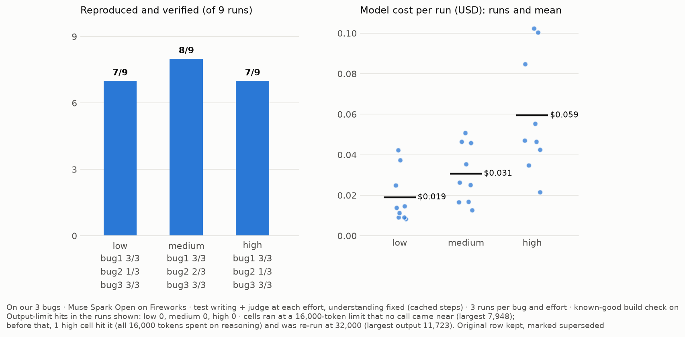
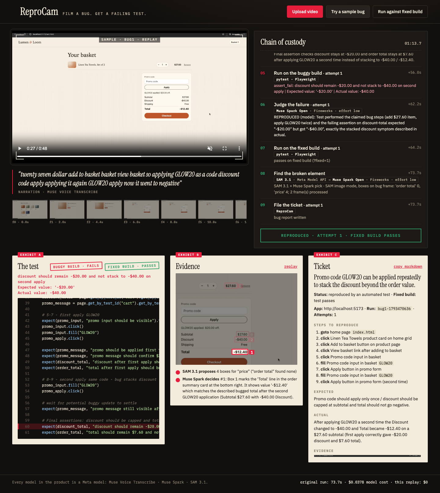

# ReproCam

Film a bug, say what went wrong, get a failing Playwright test that proves it.

> Built from scratch during the Meta Global AI Developer Hackathon (Oct 27 – Nov 4, 2026).
> No pre-existing code.

## Meta models used
- **Muse Voice Transcribe** — narration to text
- **Muse Spark / Muse Spark Open** (Meta API, Baseten, Fireworks) — understands frames, plans steps, writes the test
- **SAM 3.1** — finds the broken UI element on the bug frame (video tracking optional)

SAM proposes, Muse Spark decides: SAM 3.1 boxes the candidate elements (every price on the screen),
and Muse Spark picks the one the tester's claim is about.

## Layout
- `store/`   practice web shop with planted bugs (the app under test)
- `backend/` agent pipeline + API (FastAPI)
- `web/`     ReproCam UI
- `scripts/` setup and smoke tests
- `samples/` demo bug videos

## Setup
```bash
cp .env.example .env        # add your keys
uv venv && source .venv/bin/activate
uv pip install -r requirements.txt
playwright install chromium
python scripts/check_env.py
```

## Practice store (Lumen & Loom)
```bash
python scripts/serve_store.py          # http://localhost:5173  (buggy build)
```
Open any page with `?fixed=1` for the fixed build (`?fixed=0` to go back; the choice sticks in localStorage).
Planted bugs (registry in `store/bugs.js`, one test per id in `tests/store/test_<id>.py`):
- `neg_total`: promo `GLOW20` ($20 off) can be applied again and again; the total goes negative.
- `qty_stepper`: "−" on quantity 1 drops the line to 0 but still charges for it.
- `zip_hang`: ZIP codes starting with `0` leave the "Place order" spinner spinning forever.

Ground-truth tests assert the correct behaviour, so they fail on buggy and pass on fixed:
```bash
STORE_MODE=buggy pytest tests/store   # 8 failed (3 demo + 5 training-only bugs), 6 passed (public store hides training bugs)
STORE_MODE=fixed pytest tests/store   # 14 passed
```

## Deploy (Modal)
Live: **https://admin-34790--reprocam-web.us-east.modal.run** (practice store: `/store/`). A finished live run opens at `/?run=<id>`.

One public URL: the app at `/`, the practice store at `/store/`.
```bash
uv pip install modal "cbor2<6"          # cbor2 6.x has no wheel for Intel Macs
modal token new                          # once, opens the browser
modal secret create reprocam-keys --from-dotenv .env.prod --force   # keys live in a Modal Secret, never in the image
modal deploy deploy/modal_app.py
```

**Deploy checklist** (every deploy, and after any secret change). The web container mounts the code and reads
the secret when it starts, and it stays warm for 10 minutes, so a deploy alone can leave the old version serving.
1. Redeploy: `modal deploy deploy/modal_app.py`.
2. Stop the old container: `modal container list`, then `modal container stop -y <container id>` for each
   `reprocam` container started before the deploy. The next request starts a fresh one.
3. Check `/api/config`: `curl -s <url>/api/config` must show the expected `llm_provider` and `max_images`
   (now: `llm_provider` `baseten`, `llm_model` `meta-models/muse-spark-open-1026`, `max_images` 8,
   `understand_provider` `meta`). Then `modal container list` again: one container,
   started after the deploy.
4. One live upload via the owner link (`<url>/?owner=<OWNER_TOKEN>`, token in `.env.owner`, never shared): a
   sample recording must end REPRODUCED with the known-good check, the evidence image and the ticket. It counts
   toward the daily total, so do one.
Generated tests never run in the web container: each run gets a Modal Sandbox with **no network** (the store
is served inside the sandbox on localhost), **no secrets**, a 120 s hard timeout, 1 CPU and 2 GiB. Live runs,
uploads and budget counters live on the `reprocam-runs` Volume. Budget caps and per-IP limits apply; sample
replays cost $0.

## Effort test (reasoning effort for test writing + judging)
On our 3 bugs, 3 runs per bug at each effort (Muse Spark Open on Fireworks, understanding fixed from cached steps,
known-good build check on). "Verified" = reproduced and passing on the known-good build.

| Effort | Verified | Hit the output limit | Mean cost per run | Mean attempts | Mean time |
|---|---|---|---|---|---|
| low | 7 of 9 | 0 of 29 calls | $0.019 | 1.6 | 55 s |
| medium | 8 of 9 | 0 of 32 calls | $0.031 | 1.8 | 94 s |
| high | 7 of 9 | 1 of 33 calls at a 16,000-token limit, 0 of 34 after a re-run at 32,000 | $0.059 | 1.9 | 166 s |

All three reproduced bug1 and bug3 every time; the differences are all bug2 (low 1/3, medium 2/3, high 1/3). One run
of difference is within noise at 3 runs per cell. At high effort, one test-writing call spent its entire 16,000-token
output budget on reasoning and returned nothing; that cell was re-run at 32,000 (its first row is kept in
`data/effort_sweep.jsonl`, marked superseded), and the output limit is now 32,000 for every stage.

On our 3 bugs no effort level was clearly better (7/9, 8/9, 7/9); we use low for speed and cost.



## Known limitations
- **Invariants can be shallow.** With a known-good build, testgen v2 prefers asserting that on-screen values
  agree with each other. On bug2 it got there on the retry, but with a weak form: an if/else on the basket count
  with a hard-coded `$18.50`, not a computed quantity × price. It fails on the buggy build and passes on the
  fixed one, yet a price change would break it. One run each, so no claim of reliability yet.
- **Understanding is right about 2 runs in 3.** On our 3 bugs, the deployed understanding (Muse Spark 1.3 on the
  Meta Model API, default prompt v1, every distinct frame) got each bug's key steps right in 6 of 9 runs (bug1 3/3,
  bug2 0/3, bug3 3/3), from the same frames each time. bug2 is the weak spot: the start page loses its product id
  and "Add to basket" is skipped. On Baseten with its 8-image limit it was 5 of 9 (6 counting the run the "not the
  app" guard lets through); on Fireworks with every frame, 6 of 9 (bug1 2/3, bug2 1/3, bug3 3/3). A prompt that keeps the product id
  fixed that miss but more often mislabels the recording as "not the app" (`docs/understand_stability.md`).
- **Expected behaviour is the tester's guess.** Without a known-good build there is nothing to check the claim's
  `expected` against; such runs end "REPRODUCED · not verified".
- **SAM finds things, not meanings.** "order total" returns no boxes; "price" returns every price. Muse Spark picks
  the claimed one, and the evidence image says so.
- **Two providers in the live app.** Understanding runs on the Meta Model API (`UNDERSTAND_PROVIDER=meta`);
  live test writing, judging and the SAM box pick run on Baseten's hackathon Muse Spark Open endpoint
  (`meta-models/muse-spark-open-1026`, $100 in hackathon credits, 2M tokens per minute). It takes at most 8 images
  per request (checked Nov 1: 9 is refused), which is why understanding (13+ frames) isn't there; if it falls back
  to Baseten it keeps the first and last keyframes plus the 6 that changed most. The effort test and the
  understanding numbers for Baseten above ran before the switch (Fireworks; Baseten's `meta-models/muse-spark-open`).
  Cost estimates for Baseten calls use $1.25 / $4.25 per 1M tokens from a third-party tracker, not confirmed;
  Meta API calls aren't priced yet.
- **Local runs use a subprocess, not a sandbox.** Generated tests get no API keys locally either, but only the
  deployed app (`REPRO_SANDBOX=modal`) runs them in an isolated, network-blocked Modal Sandbox.

## Run the app
```bash
python -m backend.api        # http://localhost:8000 (also serves the store on :5173)
```
- **Try a sample bug** replays a cached run with its original timing, at $0.
- **Upload video** starts a live run (25 MB / 90 s max; daily and per-visitor caps in `.env`).
- **Run against fixed build** re-runs the reproducing test on `?fixed=1` (Playwright only, no model calls).
- **Known-good build** (optional, `KNOWN_GOOD_URL` or `--known-good fixed`): the test must also pass on a
  build without the bug, or it's retried; a run that never passes there ends *REPRODUCED · NOT CONFIRMED*.

Cache a finished run as a sample: `python scripts/cache_sample.py bug1`.


