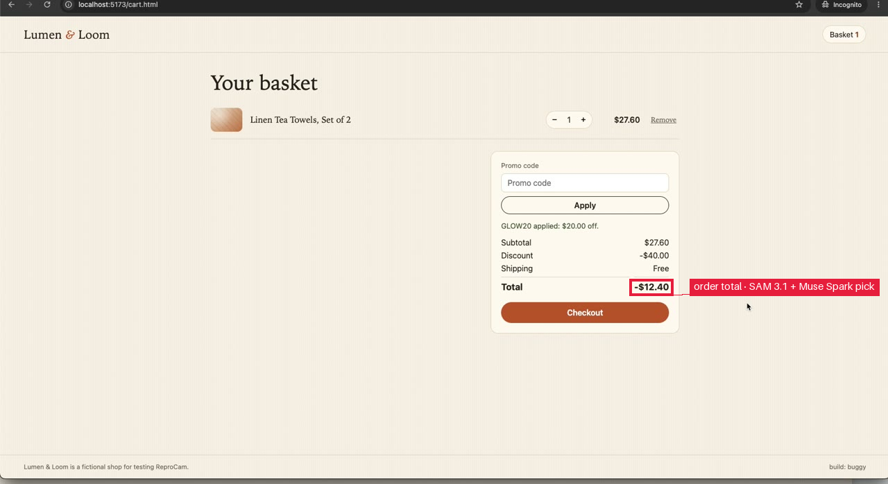

# Promo code GLOW20 can be applied repeatedly to stack the discount beyond the order value.

**Status:** reproduced by an automated test · **Fixed build:** test passes
**App:** http://localhost:5173 · **Run:** `bug1-1793470636` · **Attempts:** 1

## Steps to reproduce
1. **goto** home page `index.html`
2. **click** Linen Tea Towels product card on home grid
3. **click** Add to basket button on product page
4. **click** View basket link after adding to basket
5. **click** Promo code input in basket
6. **fill** Promo code input in basket `GLOW20`
7. **click** Apply button in promo form
8. **fill** Promo code input in basket `GLOW20`
9. **click** Apply button in promo form (second time)

## Expected
Promo code should apply only once / discount should be capped at subtotal and total should not go negative.

## Actual
After applying GLOW20 a second time the Discount changed to -$40.00 and Total became -$12.40 on a $27.60 subtotal (first apply correctly gave -$20.00 discount and $7.60 total).

## Evidence

*order total, frame 12 of the recording. Box: SAM 3.1 + Muse Spark pick.*

## Failing test
Fails on the buggy build with `builtins.AssertionError`:
```
discount should remain -$20.00 and not stack to -$40.00 on second apply
Expected value: '-$20.00'
Actual value: -$40.00
```
Judge (model): Test performed the claimed bug steps (add $27.60 item, apply GLOW20 twice) and the failing assertion on discount-total expected "-$20.00" but got "-$40.00", exactly the stacked discount symptom described in actual.

```python
import os
import re

from playwright.sync_api import Page, expect

APP_URL = os.environ.get("APP_URL", "http://localhost:5173").rstrip("/")
FIXED = os.environ.get("REPRO_FIXED", "0")


def test_reproduces_bug(page: Page):
    page.goto(f"{APP_URL}/index.html?fixed={FIXED}")

    # 2 - open Linen Tea Towels product
    product_card = page.get_by_test_id("product-card-linen-towels")
    expect(product_card, "product card should be visible").to_be_visible()
    product_card.click()

    # 3 - add to basket
    add_btn = page.get_by_test_id("product-detail").get_by_test_id("add-to-cart")
    expect(add_btn, "add to basket button should be visible").to_be_visible()
    add_btn.click()

    # 4 - view basket
    view_cart = page.get_by_test_id("product-detail").get_by_test_id("view-cart")
    expect(view_cart, "view basket link should appear after adding").to_be_visible()
    view_cart.click()

    # verify cart page loaded
    cart = page.get_by_test_id("cart")
    expect(cart, "cart should be visible").to_be_visible()
    subtotal = page.get_by_test_id("cart").get_by_test_id("cart-subtotal")
    expect(subtotal, "subtotal should be $27.60").to_have_text("$27.60")

    promo_form = page.get_by_test_id("cart").get_by_test_id("promo-form")
    promo_input = promo_form.get_by_test_id("promo-input")
    promo_apply = promo_form.get_by_test_id("promo-apply")
    order_total = page.get_by_test_id("cart").get_by_test_id("order-total")
    discount_total = page.get_by_test_id("cart").get_by_test_id("discount-total")
    promo_message = page.get_by_test_id("cart").get_by_test_id("promo-message")

    # 5-7 - first apply GLOW20
    expect(promo_input, "promo input should be visible").to_be_visible()
    promo_input.click()
    promo_input.fill("GLOW20")
    promo_apply.click()

    expect(promo_message, "promo should be applied first time").to_be_visible()
    expect(promo_message, "promo message should confirm $20 off").to_contain_text("GLOW20 applied")
    expect(discount_total, "discount after first apply should be -$20.00").to_have_text("-$20.00")
    expect(order_total, "total after first apply should be $7.60").to_have_text("$7.60")

    # 8-9 - second apply same code - bug stacks discount
    promo_input.fill("GLOW20")
    promo_apply.click()

    # wait for potential buggy update to settle
    expect(promo_message, "promo message still visible after second apply").to_be_visible()

    # Final assertions: discount should be capped and total not negative
    expect(discount_total, "discount should remain -$20.00 and not stack to -$40.00 on second apply").to_have_text("-$20.00")
    expect(order_total, "total should remain $7.60 and not go negative to -$12.40 on second apply").to_have_text("$7.60")
```

Run it: `APP_URL=<app> REPRO_FIXED=0 pytest test_repro.py` (set `REPRO_FIXED=1` for the fixed build).

*Filed by ReproCam · models: accounts/fireworks/models/muse-spark-open, muse-voice-transcribe-1.0, sam-3.1*
