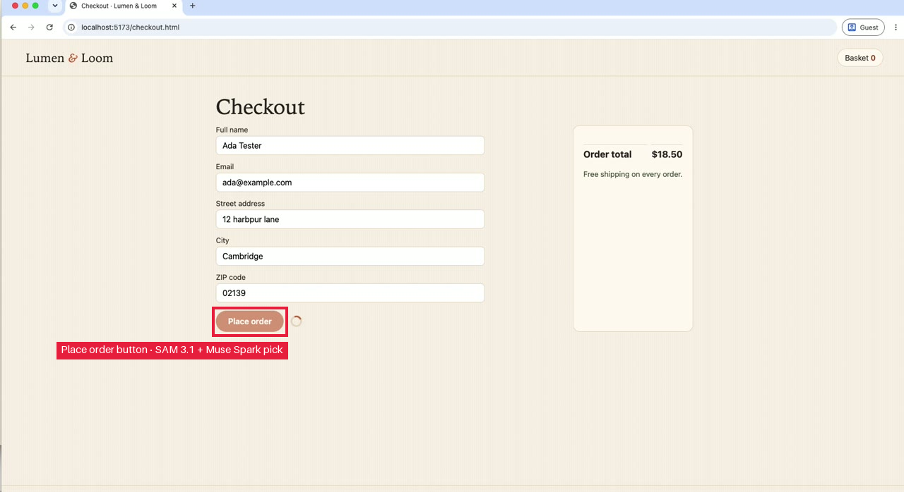

# Place order never completes and stays spinning infinitely

**Status:** REPRODUCED · verified against known-good build
**Known-good build:** fixed build (?fixed=1): test passes
**App:** http://localhost:5173 · **Run:** `bug3-1793476149` · **Attempts:** 1

## Steps to reproduce
1. **goto** cart page `cart.html`
2. **click** Increase quantity button for Pebble Night Light
3. **click** Decrease quantity button for Pebble Night Light
4. **click** Decrease quantity button for Pebble Night Light again
5. **click** Checkout link
6. **fill** Full name field in checkout form `Ada Tester`
7. **fill** Email field in checkout form `ada@example.com`
8. **fill** Street address field in checkout form `12 harfpur lane`
9. **fill** City field in checkout form `Cambridge`
10. **fill** ZIP code field in checkout form `02139`
11. **click** Place order button

## Expected
Clicking Place order should submit the checkout and navigate to order confirmation

## Actual
After filling valid checkout details and clicking Place order the button shows a Placing order spinner that spins indefinitely and no order confirmation is shown (Order total $18.50 remains on checkout page)

## Evidence

*Place order button, frame 23 of the recording. Box: SAM 3.1 + Muse Spark pick.*

## Failing test
Fails on the buggy build with `builtins.AssertionError`:
```
Clicking Place order should submit the checkout and navigate to order confirmation
Actual value: None
```
Judge (model): Test filled valid checkout and clicked Place order, expected order-confirmation; snapshot shows Checkout page stuck with progressbar "Placing order" disabled button and Order total $18.50, matching claim's infinite spinner and no confirmation.

```python
import os
import re
from urllib.parse import parse_qsl, urlencode, urlsplit, urlunsplit

from playwright.sync_api import Page, expect

APP_URL = os.environ.get("APP_URL", "http://localhost:5173").rstrip("/")
FIXED = os.environ.get("REPRO_FIXED", "0")


def url(path, **params):
    """APP_URL + path, with query params merged in. The build flag fixed=FIXED is always set."""
    parts = urlsplit(f"{APP_URL}/{path.lstrip('/')}")
    query = dict(parse_qsl(parts.query, keep_blank_values=True))
    query.update({k: str(v) for k, v in params.items()})
    query["fixed"] = FIXED
    return urlunsplit(parts._replace(query=urlencode(query)))


def test_reproduces_bug(page: Page):
    page.goto(url("product.html", id="pebble-light"))
    expect(page.get_by_test_id("product-detail")).to_be_visible()
    page.get_by_test_id("add-to-cart").click()
    expect(page.get_by_test_id("added-message")).to_be_visible()
    page.goto(url("cart.html"))
    expect(page.get_by_test_id("cart")).to_be_visible()
    expect(page.get_by_test_id("cart-count")).to_have_text("1")
    cart_line = page.get_by_test_id("cart-line-linen-towels")
    # If the cart line is for pebble-light variant, fallback to generic locators
    # The tester had Pebble Night Light in cart; locate by generic testids inside cart
    pebble_line = page.get_by_test_id("cart")
    # Increase quantity
    page.get_by_test_id("cart").get_by_test_id("qty-plus").click()
    # Decrease quantity
    page.get_by_test_id("cart").get_by_test_id("qty-minus").click()
    page.get_by_test_id("cart").get_by_test_id("qty-minus").click()
    # After decreases, quantity may be 0 and item removed or stay at 1 depending on implementation;
    # Ensure we have an item to checkout - if cart empty, re-add
    if page.get_by_test_id("cart-count").inner_text().strip() == "0":
        page.goto(url("product.html", id="pebble-light"))
        page.get_by_test_id("add-to-cart").click()
        expect(page.get_by_test_id("added-message")).to_be_visible()
        page.goto(url("cart.html"))
        expect(page.get_by_test_id("cart")).to_be_visible()
    page.get_by_test_id("checkout-button").click()
    expect(page.get_by_test_id("checkout-form")).to_be_visible()
    page.get_by_test_id("checkout-name").fill("Ada Tester")
    page.get_by_test_id("checkout-email").fill("ada@example.com")
    page.get_by_test_id("checkout-address").fill("12 harfpur lane")
    page.get_by_test_id("checkout-city").fill("Cambridge")
    page.get_by_test_id("checkout-zip").fill("02139")
    page.get_by_test_id("place-order").click()
    expect(page.get_by_test_id("order-confirmation"), "Clicking Place order should submit the checkout and navigate to order confirmation").to_be_visible(timeout=8000)
```

Run it: `APP_URL=<app> REPRO_FIXED=0 pytest test_repro.py` (`REPRO_FIXED=1` on the practice store's fixed build).

*Filed by ReproCam · models: accounts/fireworks/models/muse-spark-open, muse-voice-transcribe-1.0, sam-3.1*
